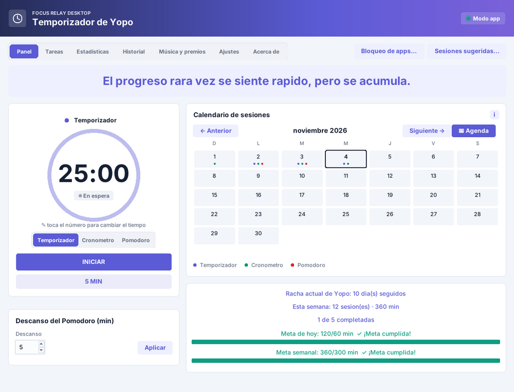
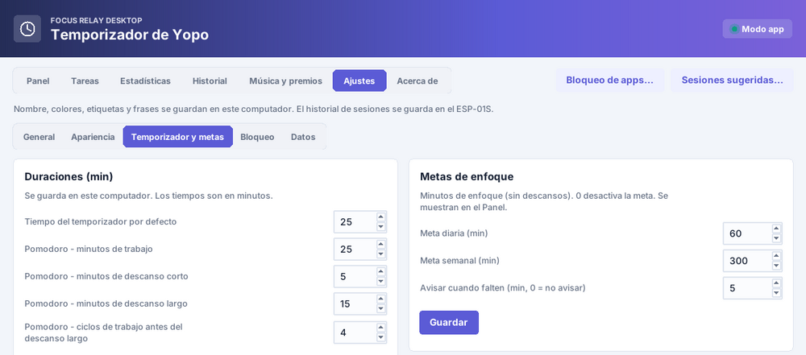

# Focus Relay

🇬🇧 [English](README.md) · 🇪🇸 Español

**Repositorio:** [https://github.com/yopo3r/Focus-Relay](https://github.com/yopo3r/Focus-Relay) — [versiones (actualizaciones)](https://github.com/yopo3r/Focus-Relay/releases) · [reportar un error](https://github.com/yopo3r/Focus-Relay/issues/new?template=bug_report.md) · [proponer una mejora](https://github.com/yopo3r/Focus-Relay/issues/new?template=feature_request.md)

Ecosistema de temporizador de estudio (Pomodoro, temporizador y cronómetro) con tres piezas que se pueden usar juntas o por separado:

| Carpeta | Qué es |
|---|---|
| [`desktop/`](desktop) | App de escritorio (Python + tkinter, Windows y Linux): panel, tareas, estadísticas, agenda, calendario, bloqueo de apps, música y premios. Funciona **sin hardware** en modo «Solo en la app». |
| [`extension/`](extension) | Extensión de Chrome mínima: bloquea sitios durante la sesión según lo que indique la app de escritorio. |
| [`firmware/`](firmware) | Sketch de Arduino para el **ESP-01S** con pantalla OLED que hace de temporizador físico (API JSON en tu red local). |




## Inicio rápido (app de escritorio)

```bash
cd desktop
pip install -r requirements.txt     # Python 3.9+
python main.py
```

En Linux: `sudo apt install python3-tk python3-gi gir1.2-ayatanaappindicator3-0.1 libnotify-bin` (ver [desktop/README.md](desktop/README.md)).
Al abrir por primera vez se muestra un tutorial; elige «Solo en la app» si no tienes el dispositivo.

## Características
- Pomodoro (con descanso corto/largo y ciclos), temporizador y cronómetro; edición del tiempo tocando el número grande.
- Tareas del día con tareas automáticas por día de la semana, sesión dedicada a una tarea (▶) y tiempo acumulado por tarea.
- Estadísticas por día/semana/mes/año, metas diaria y semanal, racha, imágenes para compartir (con frase aleatoria).
- Sonido suave al terminar una sesión o cambiar de modo en el Pomodoro, y pestaña de **Ayuda** con consejos para estudiar y sacarle provecho a la app.
- Calendario sincronizado (enlace iCal), sesiones sugeridas y **Agenda** de los próximos 14 días.
- Bloqueo de aplicaciones de escritorio (con protección para procesos críticos; aviso en una ventanita) y de sitios web (ventana propia + extensión), también durante el Cronómetro si lo eliges.
- **Modo estricto**: confirmaciones (1 a 100) y, opcionalmente, un código aleatorio para terminar antes de tiempo; ajustes y cierre de la app protegidos durante la sesión.
- Etiqueta o tarea de las próximas sesiones elegible desde el Panel; menú de la bandeja que cambia según el estado.
- Mascota flotante opcional «Brote»: arrástrala, cambia su tamaño y mantenla sobre las demás apps; te anima, celebra tus sesiones y crece con tu racha.
- 11 idiomas (es, en, fr, pt, de, it, nl, ru, ja, ko, zh), 8 temas, tamaño de texto ajustable, respaldo/restauración de datos.
- Sin cuentas, sin telemetría: todo queda en tu equipo. Ver [SECURITY.md](SECURITY.md).

## English
Focus Relay is a study-timer ecosystem: a **desktop app** (Python/tkinter, Windows & Linux, works without hardware), a **Chrome extension** and **ESP-01S firmware** for a physical timer. No accounts, no telemetry; all data stays on your machine.
Run: `cd desktop && pip install -r requirements.txt && python main.py` (Python 3.9+). The UI is available in 11 languages: Spanish, English, French, Portuguese, German, Italian, Dutch, Russian, Japanese, Korean and Chinese.

## Desarrollo
Ver [CONTRIBUTING.md](CONTRIBUTING.md) y [CHANGELOG.md](CHANGELOG.md). Licencia [MIT](LICENSE); avisos de terceros en [desktop/THIRD_PARTY_NOTICES.md](desktop/THIRD_PARTY_NOTICES.md).
