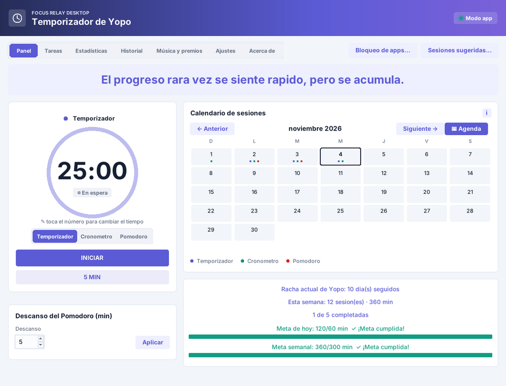
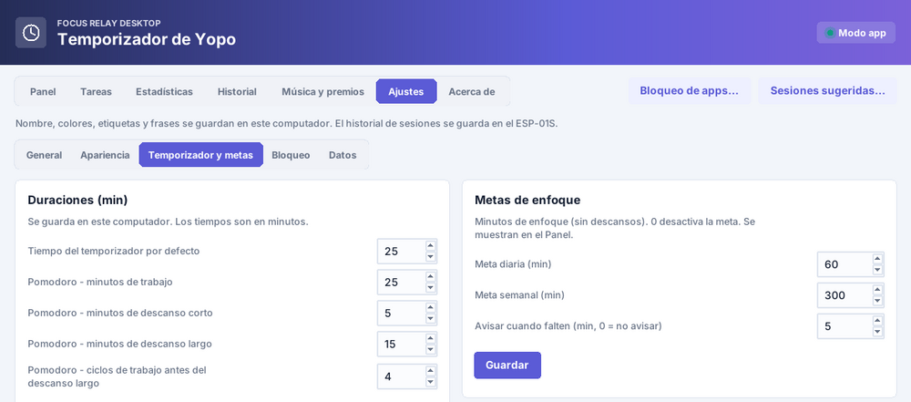

# Focus Relay

🇬🇧 English · 🇪🇸 [Español](README.es.md)

**Repository:** [https://github.com/yopo3r/Focus-Relay](https://github.com/yopo3r/Focus-Relay) — [releases (updates)](https://github.com/yopo3r/Focus-Relay/releases) · [report a bug](https://github.com/yopo3r/Focus-Relay/issues/new?template=bug_report.md) · [suggest an improvement](https://github.com/yopo3r/Focus-Relay/issues/new?template=feature_request.md)

A study-timer ecosystem (Pomodoro, timer and stopwatch) made of three parts you can use together or separately. No accounts, no telemetry: everything stays on your machine (see [SECURITY.md](SECURITY.md)).

| Folder | What it is |
|---|---|
| [`desktop/`](desktop) | Desktop app (Python + tkinter, Windows and Linux): dashboard, tasks, statistics, agenda, calendar, app blocking, music and rewards. Works **without any hardware** in "App only" mode. |
| [`extension/`](extension) | Minimal Chrome/Firefox extension: blocks websites during a session, as directed by the desktop app (the app is the control center). |
| [`firmware/`](firmware) | Arduino sketch for an **ESP-01S** with an OLED, a physical timer exposing a small JSON API on your LAN. |




## Quick start

```bash
cd desktop
pip install -r requirements.txt     # Python 3.9+
python main.py
```

Linux: `sudo apt install python3-tk python3-gi gir1.2-ayatanaappindicator3-0.1 libnotify-bin` (see [desktop/README.md](desktop/README.md)).
Prebuilt, no-Python-needed packages and installers: `desktop/install_linux.sh`, `desktop/install_windows.bat` and the GitHub Releases workflow.
On first launch a tutorial appears; pick "App only" if you don't have the device. To block websites, load `extension/` as an unpacked extension (chrome://extensions → Developer mode) or build both packages with `python tools/build_extension.py` (Firefox: see [extension/README.md](extension/README.md)).

## Features
- Pomodoro (short/long breaks, cycles), timer and stopwatch; set the time by clicking the big number.
- Daily tasks (with weekday auto-tasks), a session dedicated to a task, time per task; pick the label/task of upcoming sessions right under the clock.
- Statistics by day/week/month/year, daily and weekly goals, streaks, shareable images, trophies and rewards (a Timer or Pomodoro work phase earns a piece from 5 min, a stopwatch from 15 min).
- Optional floating mascot "Brote": drag it anywhere, double-click it to open the app, resize it, keep it above other apps; it cheers you on, celebrates finished sessions and grows with your streak.
- Adaptive "For you" suggestions learned locally from your own history.
- Synced calendar (iCal link), suggested sessions and a 14-day agenda.
- Desktop app blocking (protected system processes, small popup instead of a notification) and website blocking (own window + extension), optionally during the stopwatch too.
- **Strict mode**: N confirmations (1-100) plus an optional random code to end a session early; blocking settings, the extension port and quitting the app are locked during a session.
- Tray menu that adapts to the current state; optional start with the system.
- 11 languages (es, en, fr, pt, de, it, nl, ru, ja, ko, zh), 8 themes, adjustable text size, backup/restore.

## Development
See [CONTRIBUTING.md](CONTRIBUTING.md) and [CHANGELOG.md](CHANGELOG.md). Licensed under [MIT](LICENSE); third-party notices in [desktop/THIRD_PARTY_NOTICES.md](desktop/THIRD_PARTY_NOTICES.md).
Most in-code comments and the default UI language are Spanish; all UI strings are translated (see CONTRIBUTING).
